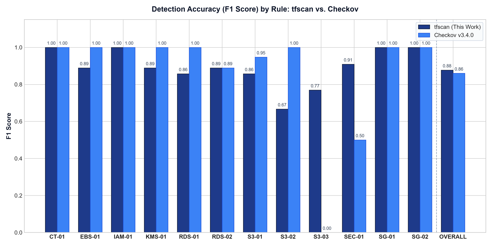

# tf-misconfig-scanner

Static Terraform security scanner for AWS infrastructure misconfigurations, featuring AST parsing via `python-hcl2`, variable propagation, deterministic UNKNOWN classification for dynamic expressions, and a measured head-to-head empirical comparison against Checkov v3.4.0.

---

## 1. Architectural Scope & Principles

`tf-misconfig-scanner` (`tfscan`) is built for deterministic static evaluation of AWS Terraform configurations without requiring cloud credentials or runtime state.

### Core Architectural Decisions:
1. **Deterministic Static AST Parsing:** Parses `.tf` files directly using `python-hcl2` backed by Lark grammar trees.
2. **Variable Resolution vs. Guessing:** Resolves static variables from `variable` default values and `.tfvars` definitions. When an attribute depends on dynamic expressions, remote data sources (`data.*`), external modules (`module.*`), or unassigned variables, the scanner emits `UNKNOWN`, never a speculative `PASS` or `FAIL`.
3. **Decoupled AWS Provider Architecture (v3 vs. v4+):** AWS provider v4 decomposed S3 attributes from monolithic bucket blocks into dedicated satellite resources (`aws_s3_bucket_public_access_block`, `aws_s3_bucket_acl`, `aws_s3_bucket_server_side_encryption_configuration`). `tfscan` constructs an in-memory relationship graph, linking satellite configurations back to parent buckets via direct references, `.id`, `.bucket`, or explicit bucket string literals.
4. **Explicit Cryptographic Governance (S3-03):** AWS enforces SSE-S3 default encryption on all buckets created after January 5, 2023. Rule `S3-03` verifies explicit cryptographic choice (e.g. KMS CMK or AES256 declared in code) to prevent configuration drift and enforce compliance baselines. Severity is calibrated as `LOW`.
5. **CI Pipeline Guardrail:** Emits standard non-zero exit codes (exit 1 on any `FAIL`) to gate pull requests and block insecure deployments. Supports Table, JSON, and SARIF v2.1.0 output for native GitHub Code Scanning integration.

---

## 2. Rule Catalog & Control Mapping

Rules are mapped to CIS and AWS controls where a clear match exists. CIS numbers are for CIS AWS Foundations Benchmark v3.0.0. Security Hub control IDs come from the AWS Security Hub user guide pages for CIS v3.0.0 and the Foundational Security Best Practices standard. Sources and the lookup date are in `docs/CONTROL_SOURCES.md`. Where no clear official match exists the field is blank (S3-02 CIS, S3-03, EBS-01 CIS, SEC-01), because the nearest CIS items cover different things: 2.1.1 is the TLS-only bucket policy and 2.2.1 is the account-level EBS default encryption setting.

| Rule ID | Rule Title | Severity | Target Resources | CIS Benchmark | AWS Security Hub control | Checkov ID |
|---|---|---|---|---|---|---|
| **S3-01** | S3 bucket has no public access block with all four settings true | HIGH | `aws_s3_bucket`, `aws_s3_bucket_public_access_block` | CIS AWS v3.0.0 2.1.4 | [S3.1] | CKV2_AWS_6 |
| **S3-02** | S3 bucket ACL is `public-read` or `public-read-write` | HIGH | `aws_s3_bucket`, `aws_s3_bucket_acl` |  | [S3.2], [S3.3] | CKV_AWS_20, CKV_AWS_57 |
| **S3-03** | S3 bucket has no explicit server-side encryption configuration | LOW | `aws_s3_bucket`, `aws_s3_bucket_server_side_encryption_configuration` |  |  | CKV_AWS_19 |
| **SG-01** | Security group allows ingress from `0.0.0.0/0` or `::/0` on port 22 | HIGH | `aws_security_group`, `aws_security_group_rule` | CIS AWS v3.0.0 5.2, 5.3 | [EC2.53], [EC2.54] | CKV_AWS_24 |
| **SG-02** | Security group allows ingress from `0.0.0.0/0` or `::/0` on port 3389 | HIGH | `aws_security_group`, `aws_security_group_rule` | CIS AWS v3.0.0 5.2, 5.3 | [EC2.53], [EC2.54] | CKV_AWS_25 |
| **RDS-01** | RDS instance has `publicly_accessible = true` | HIGH | `aws_db_instance` | CIS AWS v3.0.0 2.3.3 | [RDS.2] | CKV_AWS_17 |
| **RDS-02** | RDS instance has `storage_encrypted` false or missing | HIGH | `aws_db_instance` | CIS AWS v3.0.0 2.3.1 | [RDS.3] | CKV_AWS_16 |
| **EBS-01** | EBS volume has `encrypted` false or missing | HIGH | `aws_ebs_volume` |  | [EC2.3] | CKV_AWS_3 |
| **CT-01** | CloudTrail trail is not multi-region, or log file validation is off | HIGH | `aws_cloudtrail` | CIS AWS v3.0.0 3.1, 3.2 | [CloudTrail.1], [CloudTrail.4] | CKV_AWS_67, CKV_AWS_36 |
| **IAM-01** | IAM policy document allows `Action: "*"` on `Resource: "*"` | CRITICAL | `aws_iam_policy`, `aws_iam_role_policy`, `aws_iam_user_policy`, `aws_iam_group_policy` | CIS AWS v3.0.0 1.16 | [IAM.1] | CKV_AWS_62 |
| **KMS-01** | KMS key has `enable_key_rotation` false or missing | MEDIUM | `aws_kms_key` | CIS AWS v3.0.0 3.6 | [KMS.4] | CKV_AWS_7 |
| **SEC-01** | Hard-coded secret literals in provider or resource arguments | HIGH | `provider.aws`, resource arguments (`password`, `access_key`, `secret_key`) |  |  | CKV_AWS_41 |

Full control source definitions are recorded in [`docs/CONTROL_SOURCES.md`](file:///c:/Users/Rajch/Desktop/Research/tf-misconfig-scanner/docs/CONTROL_SOURCES.md). Checkov policy cross-references are documented in [`docs/checkov_mapping.csv`](file:///c:/Users/Rajch/Desktop/Research/tf-misconfig-scanner/docs/checkov_mapping.csv).

---

## 3. Installation & Usage

### Installation
```bash
git clone https://github.com/rajchhapariya/tf-misconfig-scanner.git
cd tf-misconfig-scanner
pip install -e .
```

### CLI Command Syntax
```bash
# Terminal table format (default)
tfscan scan ./terraform/aws

# Machine-readable JSON output
tfscan scan ./terraform/aws --format json

# SARIF output for GitHub Code Scanning
tfscan scan ./terraform/aws --format sarif --output results/scan.sarif
```

---

## 4. Benchmark Methodology & Ground-Truth Dataset

To prevent evaluation bias, all ground-truth labels were assigned by reading source code before running any scanner.

1. **Hand-Written Fixtures (`fixtures/`):**
   - 97 distinct `.tf` configurations across all 12 rules.
   - Contains >= 3 FAIL cases, >= 3 PASS cases, and >= 2 UNKNOWN cases per rule.
   - Tests both AWS provider v3 and v4+ styles, variable substitution, and unresolvable references.
   - Three fixture and label changes were made after the first scanner run; each is listed in [`docs/LABEL_CHANGES.md`](docs/LABEL_CHANGES.md).
   - Labels recorded in [`labels/fixture_labels.csv`](file:///c:/Users/Rajch/Desktop/Research/tf-misconfig-scanner/labels/fixture_labels.csv).

2. **TerraGoat AWS Target (`data/terragoat/`):**
   - Bridgecrew's open-source deliberately vulnerable infrastructure repository.
   - Fetched via [`scripts/fetch_terragoat.sh`](file:///c:/Users/Rajch/Desktop/Research/tf-misconfig-scanner/scripts/fetch_terragoat.sh) pinned at commit `729f8da62c6a85ce4af5ad3d123de97776d954c4`.
   - 34 (resource, rule) pairs labeled in [`labels/terragoat_labels.csv`](file:///c:/Users/Rajch/Desktop/Research/tf-misconfig-scanner/labels/terragoat_labels.csv).

<!-- RESULTS:START -->
## Measured evaluation and Checkov comparison

Read these caveats first.

- The fixtures were written together with the scanner, so tfscan scoring well on them is expected and is weak evidence. TerraGoat is the independent set, and it has only 33 scored items.
- TerraGoat was built by Bridgecrew, the company behind Checkov, so Checkov is expected to do well on it.
- S3-03 asks for an explicit encryption choice in code. Checkov check CKV_AWS_19 passes buckets with no configuration, so the two tools answer different questions on S3-03. The second aggregate row leaves it out.
- A mapped Checkov check that never ran on an item counts as a miss (FN if the label is FAIL). The last column shows how many items that affects. SEC-01 maps only to the provider check CKV_AWS_41, so Checkov's separate secrets scanner is not part of this comparison.
- UNKNOWN-labelled items are not in precision or recall. tfscan answered UNKNOWN on its UNKNOWN items 24 of 24 times; Checkov has no UNKNOWN state and gave a FAIL or PASS on 8 of them.
- Wall times include process start-up; Checkov's start-up is a large part of its time on small inputs. Single run each, no repetition.

### Precision, recall and F1 per rule

| Rule | Scored items | tfscan P | tfscan R | tfscan F1 | tfscan UNKNOWN rate | Checkov P | Checkov R | Checkov F1 | Checkov items with no mapped check |
|---|---|---|---|---|---|---|---|---|---|
| CT-01: CloudTrail trail is not multi-region or log file validation is off | 6 | 100.0% | 100.0% | 1.000 | 25.0% | 100.0% | 100.0% | 1.000 | 0 |
| EBS-01: EBS volume has encrypted false or missing | 7 | 100.0% | 100.0% | 1.000 | 22.2% | 100.0% | 100.0% | 1.000 | 2 |
| IAM-01: IAM policy document allows Action: "*" on Resource: "*" | 8 | 100.0% | 100.0% | 1.000 | 20.0% | 100.0% | 100.0% | 1.000 | 0 |
| KMS-01: KMS key has enable_key_rotation false or missing | 7 | 100.0% | 100.0% | 1.000 | 22.2% | 100.0% | 100.0% | 1.000 | 2 |
| RDS-01: RDS instance has publicly_accessible = true | 7 | 100.0% | 100.0% | 1.000 | 22.2% | 100.0% | 100.0% | 1.000 | 2 |
| RDS-02: RDS instance has storage_encrypted false or missing | 7 | 100.0% | 100.0% | 1.000 | 22.2% | 100.0% | 100.0% | 1.000 | 2 |
| S3-01: S3 bucket has no public access block with all four settings true | 12 | 100.0% | 100.0% | 1.000 | 14.3% | 90.0% | 100.0% | 0.947 | 2 |
| S3-02: S3 bucket ACL is public-read or public-read-write | 12 | 100.0% | 100.0% | 1.000 | 14.3% | 100.0% | 100.0% | 1.000 | 2 |
| S3-03: S3 bucket has no explicit server-side encryption configuration | 13 | 100.0% | 100.0% | 1.000 | 13.3% | n/a | 0.0% | n/a | 2 |
| SEC-01: Hard-coded secret-like literals in provider or resource arguments | 9 | 100.0% | 100.0% | 1.000 | 18.2% | 100.0% | 40.0% | 0.571 | 6 |
| SG-01: Security group allows ingress from 0.0.0.0/0 or ::/0 on port 22 | 9 | 100.0% | 100.0% | 1.000 | 18.2% | 100.0% | 100.0% | 1.000 | 0 |
| SG-02: Security group allows ingress from 0.0.0.0/0 or ::/0 on port 3389 | 9 | 100.0% | 100.0% | 1.000 | 18.2% | 100.0% | 100.0% | 1.000 | 0 |
| All 12 rules | 106 | 100.0% | 100.0% | 1.000 | 18.5% | 97.7% | 79.6% | 0.878 | 20 |
| All rules except S3-03 | 93 | 100.0% | 100.0% | 1.000 | 19.1% | 97.7% | 93.5% | 0.956 | 18 |
| fixtures only (all 12 rules) | 73 | 100.0% | 100.0% | 1.000 | 24.7% | 96.9% | 86.1% | 0.912 | 19 |
| terragoat only (all 12 rules) | 33 | 100.0% | 100.0% | 1.000 | 0.0% | 100.0% | 66.7% | 0.800 | 1 |

### Scan time

| Dataset | Resources | tfscan engine | tfscan CLI wall | Checkov wall | tfscan CLI ms/100 res | Checkov ms/100 res | Wall-time ratio |
|---|---|---|---|---|---|---|---|
| Fixtures (one directory per fixture for tfscan) | 102 | 3567 ms | 2405 ms | 14537 ms | 2358 | 14252 | 6.0x |
| TerraGoat AWS | 17 | 240 ms | 623 ms | 2490 ms | 3664 | 14644 | 4.0x |

### F1 per rule



### Disagreements

Every labelled item where the two tools gave different verdicts. The Note column is the only hand-written part (docs/disagreement_notes.csv).

| Dataset | File | Resource | Rule | Label | tfscan | Checkov | Right | Note |
|---|---|---|---|---|---|---|---|---|
| Fixtures | `fixtures/S3-01/pass/case3_v4_pab_linked_by_name.tf` | `` | S3-01 | PASS | PASS | FAIL | tfscan | Public access block is linked to the bucket by a literal bucket name, not a resource reference; tfscan resolves it, Checkov CKV2_AWS_6 reported FAIL. |
| Fixtures | `fixtures/S3-03/fail/case1_v3_no_sse.tf` | `` | S3-03 | FAIL | FAIL | PASS | tfscan | Checkov CKV_AWS_19 (graph_checks/aws/S3BucketEncryption.json in Checkov 3.4.0) passes a bucket with no encryption configuration; tfscan S3-03 deliberately fails it as no explicit choice in code. |
| Fixtures | `fixtures/S3-03/fail/case2_v4_no_sse.tf` | `` | S3-03 | FAIL | FAIL | PASS | tfscan | Checkov CKV_AWS_19 (graph_checks/aws/S3BucketEncryption.json in Checkov 3.4.0) passes a bucket with no encryption configuration; tfscan S3-03 deliberately fails it as no explicit choice in code. |
| Fixtures | `fixtures/S3-03/fail/case3_v4_unrelated_resource.tf` | `` | S3-03 | FAIL | FAIL | PASS | tfscan | Checkov CKV_AWS_19 (graph_checks/aws/S3BucketEncryption.json in Checkov 3.4.0) passes a bucket with no encryption configuration; tfscan S3-03 deliberately fails it as no explicit choice in code. |
| Fixtures | `fixtures/SG-01/unknown/case1_cidr_variable.tf` | `` | SG-01 | UNKNOWN | UNKNOWN | PASS | n/a (unknowable) | Unresolved value: tfscan returned UNKNOWN; Checkov returned PASS from its mapped check (no UNKNOWN state). |
| Fixtures | `fixtures/SG-01/unknown/case2_port_variable.tf` | `` | SG-01 | UNKNOWN | UNKNOWN | PASS | n/a (unknowable) | Unresolved value: tfscan returned UNKNOWN; Checkov returned PASS from its mapped check (no UNKNOWN state). |
| Fixtures | `fixtures/SG-02/unknown/case1_cidr_var.tf` | `` | SG-02 | UNKNOWN | UNKNOWN | PASS | n/a (unknowable) | Unresolved value: tfscan returned UNKNOWN; Checkov returned PASS from its mapped check (no UNKNOWN state). |
| Fixtures | `fixtures/SG-02/unknown/case2_rule_remote_state.tf` | `` | SG-02 | UNKNOWN | UNKNOWN | PASS | n/a (unknowable) | Unresolved value: tfscan returned UNKNOWN; Checkov returned PASS from its mapped check (no UNKNOWN state). |
| Fixtures | `fixtures/CT-01/unknown/case1_unresolved_multi_region.tf` | `` | CT-01 | UNKNOWN | UNKNOWN | PASS | n/a (unknowable) | Unresolved value: tfscan returned UNKNOWN; Checkov returned PASS from its mapped check (no UNKNOWN state). |
| Fixtures | `fixtures/CT-01/unknown/case2_unresolved_validation.tf` | `` | CT-01 | UNKNOWN | UNKNOWN | PASS | n/a (unknowable) | Unresolved value: tfscan returned UNKNOWN; Checkov returned PASS from its mapped check (no UNKNOWN state). |
| Fixtures | `fixtures/IAM-01/unknown/case1_policy_variable.tf` | `` | IAM-01 | UNKNOWN | UNKNOWN | PASS | n/a (unknowable) | Unresolved value: tfscan returned UNKNOWN; Checkov returned PASS from its mapped check (no UNKNOWN state). |
| Fixtures | `fixtures/IAM-01/unknown/case2_template_file.tf` | `` | IAM-01 | UNKNOWN | UNKNOWN | PASS | n/a (unknowable) | Unresolved value: tfscan returned UNKNOWN; Checkov returned PASS from its mapped check (no UNKNOWN state). |
| Fixtures | `fixtures/SEC-01/fail/case2_db_literal_password.tf` | `` | SEC-01 | FAIL | FAIL | NO_CHECK | tfscan | CKV_AWS_41 only inspects provider blocks; Checkov's separate CKV_SECRET_* secrets scanner is not in docs/checkov_mapping.csv, so no mapped check ran on this resource. |
| Fixtures | `fixtures/SEC-01/fail/case3_resolved_default_password.tf` | `` | SEC-01 | FAIL | FAIL | NO_CHECK | tfscan | CKV_AWS_41 only inspects provider blocks; Checkov's separate CKV_SECRET_* secrets scanner is not in docs/checkov_mapping.csv, so no mapped check ran on this resource. |
| Fixtures | `fixtures/SEC-01/pass/case2_var_no_default.tf` | `` | SEC-01 | PASS | PASS | NO_CHECK | tfscan | CKV_AWS_41 only inspects provider blocks; Checkov's separate CKV_SECRET_* secrets scanner is not in docs/checkov_mapping.csv, so no mapped check ran on this resource. |
| TerraGoat | `s3.tf` | `aws_s3_bucket.data` | S3-03 | FAIL | FAIL | PASS | tfscan | Checkov CKV_AWS_19 (graph_checks/aws/S3BucketEncryption.json in Checkov 3.4.0) passes a bucket with no encryption configuration; tfscan S3-03 deliberately fails it as no explicit choice in code. |
| TerraGoat | `s3.tf` | `aws_s3_bucket.financials` | S3-03 | FAIL | FAIL | PASS | tfscan | Checkov CKV_AWS_19 (graph_checks/aws/S3BucketEncryption.json in Checkov 3.4.0) passes a bucket with no encryption configuration; tfscan S3-03 deliberately fails it as no explicit choice in code. |
| TerraGoat | `s3.tf` | `aws_s3_bucket.operations` | S3-03 | FAIL | FAIL | PASS | tfscan | Checkov CKV_AWS_19 (graph_checks/aws/S3BucketEncryption.json in Checkov 3.4.0) passes a bucket with no encryption configuration; tfscan S3-03 deliberately fails it as no explicit choice in code. |
| TerraGoat | `s3.tf` | `aws_s3_bucket.data_science` | S3-03 | FAIL | FAIL | PASS | tfscan | Checkov CKV_AWS_19 (graph_checks/aws/S3BucketEncryption.json in Checkov 3.4.0) passes a bucket with no encryption configuration; tfscan S3-03 deliberately fails it as no explicit choice in code. |
| TerraGoat | `ec2.tf` | `aws_s3_bucket.flowbucket` | S3-03 | FAIL | FAIL | PASS | tfscan | Checkov CKV_AWS_19 (graph_checks/aws/S3BucketEncryption.json in Checkov 3.4.0) passes a bucket with no encryption configuration; tfscan S3-03 deliberately fails it as no explicit choice in code. |
| TerraGoat | `db-app.tf` | `aws_db_instance.default` | SEC-01 | FAIL | FAIL | NO_CHECK | tfscan | CKV_AWS_41 only inspects provider blocks; Checkov's separate CKV_SECRET_* secrets scanner is not in docs/checkov_mapping.csv, so no mapped check ran on this resource. |
<!-- RESULTS:END -->

---

## Reproducing the results

```bash
pip install -e . pytest checkov==3.4.0 matplotlib
bash scripts/fetch_terragoat.sh
python scripts/build_fixtures.py
python -m pytest
python eval/run_scans.py
python -m eval.score
python -m eval.disagreements
python -m eval.plot_figure
python -m eval.generate_artifacts
python report/generate_report.py   # needs the typst CLI
```

`python-hcl2` is pinned to 8.1.4. Its output format changed between releases (block labels keep their quotes), and the parser is written against 8.1.4.

---

## 5. Architectural Rationale & Threat Model Evaluation

### 5.1 Static AST Analysis vs. Deploy-Time State
Static analysis inspects code tokens and HCL abstract syntax trees prior to execution. It has no visibility into:
- External data sources (`data.aws_ssm_parameter` or `data.terraform_remote_state`) whose values are fetched via network APIs during `terraform plan` or `apply`.
- Module outputs produced by third-party remote modules.
- Account-level or organization-level AWS defaults configured outside code (e.g., account-level S3 Public Access Block or default EBS encryption).
- Out-of-band state drifts caused by direct AWS Console or CLI modifications.

### 5.2 Deterministic UNKNOWN Evaluation vs. Heuristic Guessing
Assuming an unresolvable variable defaults to a secure value (e.g., assuming `publicly_accessible` defaults to `false` when set to an unresolvable variable `var.expose_db`) introduces false negatives if the value is `true` at runtime, creating security blind spots. Conversely, guessing `true` creates false positive alert fatigue. 
By classifying unresolvable inputs as `UNKNOWN`, `tfscan` flags configurations requiring manual inspection or pipeline input validation. This boundary trades recall (an unresolvable value that is vulnerable at deploy time is reported as `UNKNOWN`, not `FAIL`) for never guessing. On the scored items below tfscan made no false positive and no false negative, but the fixtures were written alongside the scanner, so that is a regression result and not evidence of accuracy on unseen code.

### 5.3 Strict Compliance Evaluation: S3-01 Public Access Blocks
For `S3-01` (Public Access Block), `tfscan` requires that all four block settings (`block_public_acls`, `block_public_policy`, `ignore_public_acls`, `restrict_public_buckets`) evaluate strictly to `true`. If an organization configures 3 out of 4 settings, `tfscan` flags it as `FAIL`. This strict posture prioritizes public bucket prevention, choosing to flag partially protected buckets rather than assuming incomplete blocks provide adequate defense-in-depth.

### 5.4 Graph Linkage Discrepancy Case Study (CKV2_AWS_6)
On fixture `case3_v4_pab_linked_by_name.tf`, an S3 bucket is secured by an `aws_s3_bucket_public_access_block` where the bucket is referenced via a matching string literal name (`bucket = "secure-corporate-logs"`).
- `tfscan` traversed the resource association graph, matched the literal name to the bucket declaration, verified all 4 settings, and returned `PASS`.
- `Checkov` failed to link the standalone resource because its graph check (`CKV2_AWS_6`) expected an explicit HCL interpolation (`aws_s3_bucket.b.id`), resulting in a false positive (`FAIL`). `tfscan` handles this valid Terraform idiom correctly.

### 5.5 Regulatory Alignment with CIS AWS Foundations Benchmark
The Center for Internet Security (CIS) Benchmarks provide consensus-driven, vendor-agnostic cybersecurity best practice guidelines authored by global communities of security professionals. Auditors mandate CIS compliance because:
- They establish objective, measurable, and auditable baselines.
- They map directly to regulatory compliance frameworks (NIST SP 800-53, PCI-DSS, HIPAA, ISO/IEC 27001, SOC 2).
- They eliminate subjective opinions on whether an infrastructure configuration is sufficiently hardened.

### 5.6 CI/CD Gatekeeper Integration
`tfscan` functions as a gatekeeper in automated CI/CD workflows:
1. **Pull Request Trigger:** Runs on pull requests modifying `.tf` or `.tfvars` files.
2. **Exit Code Gating:** Returns exit code 1 whenever any `FAIL` finding is detected, immediately failing the CI status check and preventing pull request merge.
3. **Code Scanning SARIF Export:** Generates SARIF v2.1.0 output uploaded via `github/codeql-action/upload-sarif`, annotating vulnerable lines directly in the pull request diff view.
